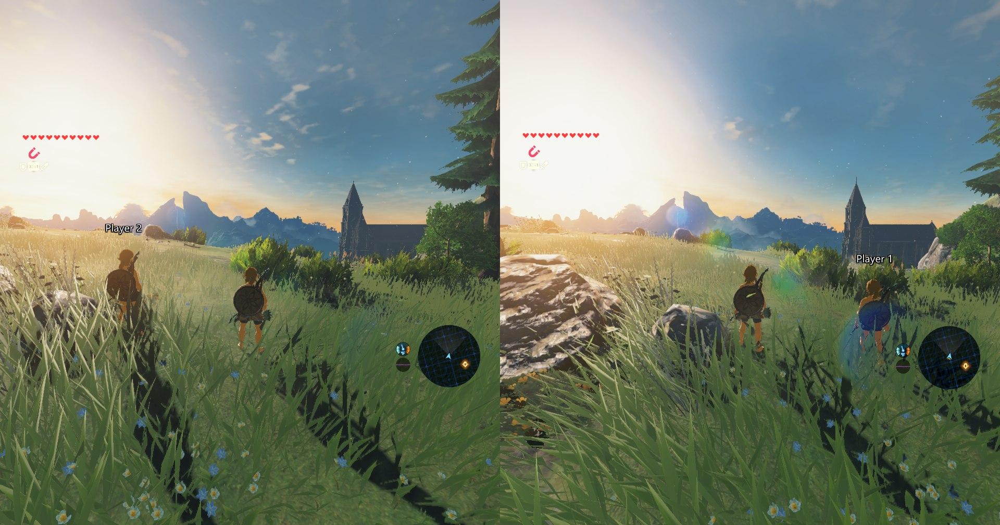
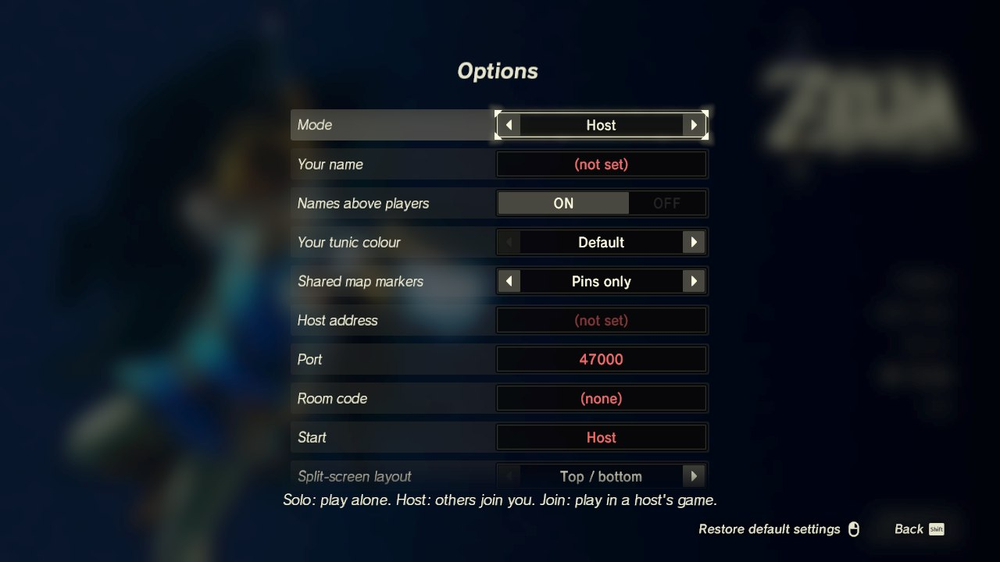
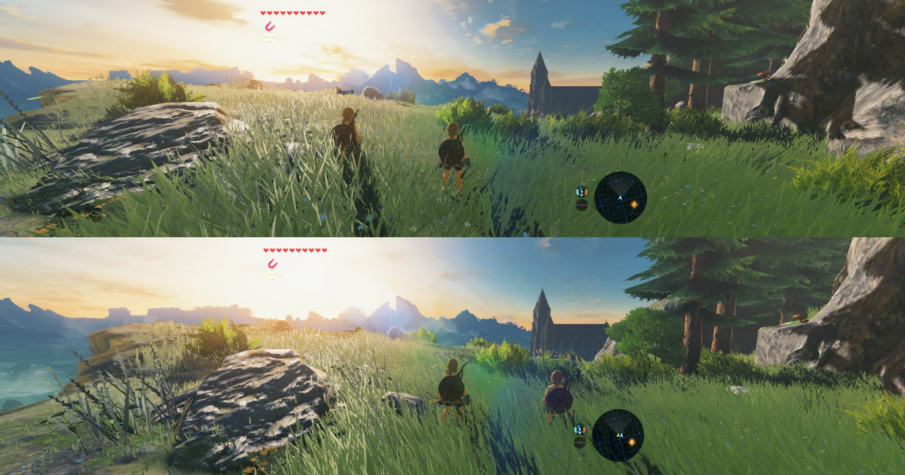

<div align="center">

# Savage Wind Co-op

**Explore Hyrule together.** Online and split-screen co-op for
[Savage Wind](https://github.com/Revivedx/SavageWindRecomp), the native PC version of
*The Legend of Zelda: Breath of the Wild*.

[](https://github.com/Jaumjvrs/SavageWind-Coop/releases/latest)
&nbsp;

&nbsp;

&nbsp;




</div>

> [!IMPORTANT]
> This is an unofficial fan project. **No game files are included and none are downloaded.** You need Savage Wind
> already set up and working with your own legally obtained copy of the game. Each player's co-op files are made on
> their own PC from their own game files.

> [!NOTE]
> **Vibe-coded with AI.** Almost all of the code, the research into how the game works, the tests and these
> docs were written by AI coding assistants (mainly Anthropic's Claude, with help from OpenAI's Codex and Google's
> Gemini), following my direction, and play-tested online by me and my friends. I'm a programmer, but I only lightly reviewed the code myself:
> most of the checking was done by those same AI tools and by playing. If you'd rather not use AI-made software, now
> you know.

## Features

|   |   |
|---|---|
| 🌍 **Online co-op** | Up to 8 players over the internet. One hosts, the others join with the host's address and a private room code. |
| 🎮 **Split screen** | Two players on one PC, in one window, side by side or top and bottom, each with their own controller. Player 2 can hear their game on headphones. |
| 🧝 **See each other** | The other Link appears in your world with their gear, armor colors, animations, aim, bow, paraglider, horse and Master Cycle, with a name tag and a marker on your map. |
| ⚔️ **Fight together** | Enemies are in the same place for everyone, with one shared health bar, and go after whoever is nearer. Bosses work the same way. |
| 🏹 **Hits reach each other** | Enemy arrows, rocks, fireballs and Guardian lasers aimed at your partner hurt them, with fire, ice and shock effects. Your own hits on each other are friendly: small and never deadly. |
| 🧩 **Puzzles together** | Physics objects, switches, crystals, water wheels, water levels, timers, rail lifts, motion-control platforms, doors and elevators stay in step in shrines, Divine Beasts and the open world. |
| 🪄 **Runes and powers** | Your partner's Magnesis beam, Stasis chains, Cryonis blocks and Champion abilities show in your game; objects they move or freeze move or freeze for you too. |
| 🌦️ **One world** | Time of day, weather, chests and items picked up near each other, cut trees and grass, fires, map pins, Captured Memories, story, shrine and Divine Beast progress. Random enemies and animals are shared too. |
| 🎬 **Story moments together** | Shrine doors, the monk at the end of a shrine and many cutscenes play for both players at the same time. |
| 🍲 **Help each other** | Hand a cooked dish to a friend standing next to you, or light your torch from theirs. |
| 🔌 **Easy hosting** | The game opens the co-op port on your router by itself (UPnP) and shows the address to send your friends. |
| 💾 **Your save is safe** | Co-op plays on its own copy of your save; your normal save is never changed. |

<div align="center">



</div>

## Quick start

**You need:** a Windows PC with [Savage Wind](https://github.com/Revivedx/SavageWindRecomp)
**0.6.0-alpha.6** that already starts and plays normally.

1. Download **`SavageWind-Coop.zip`** from the [latest release](https://github.com/Jaumjvrs/SavageWind-Coop/releases/latest).
   Everyone playing together needs the same version.
2. Extract it and put its **`Co-op`** folder inside your Savage Wind folder, next to `savagewind.exe`.
3. Start **`Co-op\Savage Wind Co-op.exe`**. The first time, it prepares the co-op files from your game files
   (about a minute). On the title screen choose **Co-op**:
   - **Split screen:** pick a layout and player 2's controller, then **Add player 2**.
   - **Host online:** mode **Host**, your name, **Start**. Send your friends the address and room code it shows.
   - **Join online:** mode **Join**, the host's address and room code, **Start**.
4. Choose **Continue** or **New Game** and play. The other player appears a few seconds after you are both in the
   world.

> [!TIP]
> **Two Windows messages you may see the first time:**
> - *"Windows protected your PC"*: the program is not code-signed, like most free mods. Click **More info** and
>   **Run anyway**.
> - *"Allow this app on networks?"* (when hosting): click **Allow**, or your friends can't connect.

The full player guide, with hosting help and fixes for common problems, is **[COOP-HOWTO.md](Co-op/COOP-HOWTO.md)**.

### Hosting online

The host's PC must be reachable from the internet on **UDP port 47000**. When you host, the game asks your router
to open that port (UPnP) and closes it again when you stop. The Co-op menu shows whether it worked and copies your
address for you. If your router doesn't allow it, forward UDP 47000 by hand, let a friend host, or use a VPN such as
Tailscale. Players who join, and split-screen play, need no network setup.

<div align="center">



</div>

## How it works

Each player runs their own full copy of the game. The mod adds code to Savage Wind's game program that sends what
matters to the other players several times a second (positions, animations, enemies, objects, progress) over a small,
versioned UDP protocol (peer to peer: no server of ours in between), and keeps the copies in step:

- **One owner per shared thing.** Each enemy is run by one player's game (normally the nearer player's) and copied
  by the others, so there is one health bar and one target. A physics object belongs to whoever moved it last.
- **The game's own rules.** Where it can, the mod calls the game's own functions (to hurt Link, open a door, start a
  cutscene, turn a water wheel) instead of writing memory, so effects, sounds and reactions look like the normal game.
- **Your own game files.** The download holds no game files. The first start builds the co-op files (the other
  players' figures and the gear they carry) from your own copy of the game.
- **Room code.** Every packet carries a tag made with a key from the room code; packets without the right tag are
  dropped, and every value received is checked before it is used.

Every co-op feature can be turned off by itself with an environment variable `SAVAGEWIND_COOP_<NAME>=0`.

## Build it yourself

Don't want to run `.exe` files from the internet? Build the same `Co-op` folder from this source on your own PC:

```powershell
git clone -c core.autocrlf=false https://github.com/Jaumjvrs/SavageWind-Coop.git
cd SavageWind-Coop
powershell -ExecutionPolicy Bypass -File Co-op\build_coop.ps1 -Setup
```

It installs the build tools the first time (`-Setup`), needs no game files, and leaves the folder in
`build\coop-dist\Co-op`. Details and what each step does: **[BUILDING.md](BUILDING.md)**.

## Common questions

**Do I need to own the game?** Yes. Savage Wind and this mod use your own game files; nothing from the game is
included here.

**Does it change my save?** No. Co-op plays on its own copy of your save, made the first time.

**My friend can't connect.** Check that you both use the same co-op version and the same room code, that the host
clicked **Allow** in the Windows network question, and that the Co-op menu says the router port is open. Some
internet providers share one address between many homes (CGNAT); then nobody can reach that PC from outside: let
another player host, or use a VPN such as Tailscale.

**Savage Wind updated and the mod won't start.** Each co-op version is made for one Savage Wind version. Wait for a
co-op release that matches the new Savage Wind.

**Is it safe to play with strangers?** The room code keeps out anyone who doesn't have it. Players inside your room
can change shared things in your game (items, progress), so only play with people you trust.

## Known limits

- Experimental: expect bugs, and keep backups of saves you care about.
- Players only see each other in the same area (the open world, or the same shrine or Divine Beast).
- Each player gets their own loot from enemies and broken objects (everyone gets a share).
- Birds, fish and insects that appear at random are each player's own.
- Some rare puzzles, cutscenes and boss fights haven't been tried in co-op yet. Tell us what breaks.
- Windows only.

## For developers

This repository is the full Savage Wind source with the co-op code added. Build it like Savage Wind itself (see
[docs/SAVAGE-WIND-README.md](docs/SAVAGE-WIND-README.md)); the co-op code is part of the normal build.
[BUILDING.md](BUILDING.md) makes the player folder (`Co-op/build_coop.sh`).

| Path | What |
|---|---|
| `runtime/coop.c`, `runtime/coop/*.inc` | Game side: players, enemies, objects, world state. |
| `runtime/coop_net.c`, `runtime/coop_net.h` | The UDP network protocol (versioned; every received value is checked). |
| `runtime/coop_upnp.cpp`, `runtime/coop_upnp_logic.c` | Opening the host's router port (UPnP). |
| `runtime/coop_split.cpp`, `runtime/ui/coop_menu.mm` | Split screen and the in-game Co-op menu. |
| `tests/test_coop_net.c` | Protocol unit tests. |
| `Co-op/` | Starter program source (`launcher/`), setup script (`build_overlay.py` builds the co-op files from the player's own game files), guide and packaging. |

Every co-op feature has an off switch, an environment variable `SAVAGEWIND_COOP_<NAME>=0`. Release history:
[CHANGELOG.md](Co-op/CHANGELOG.md).

## Security

Found a way to crash or take over a co-op player's game over the network? Please report it privately (see
[SECURITY.md](SECURITY.md)) instead of opening a public issue.

## Credits and license

Thanks to my friends who play-tested co-op online with me.

Built on [Savage Wind](https://github.com/Revivedx/SavageWindRecomp) by Revivedx and contributors. MIT license (see
[LICENSE](LICENSE)). *The Legend of Zelda: Breath of the Wild* is © Nintendo. This project is not affiliated with or
endorsed by Nintendo.
